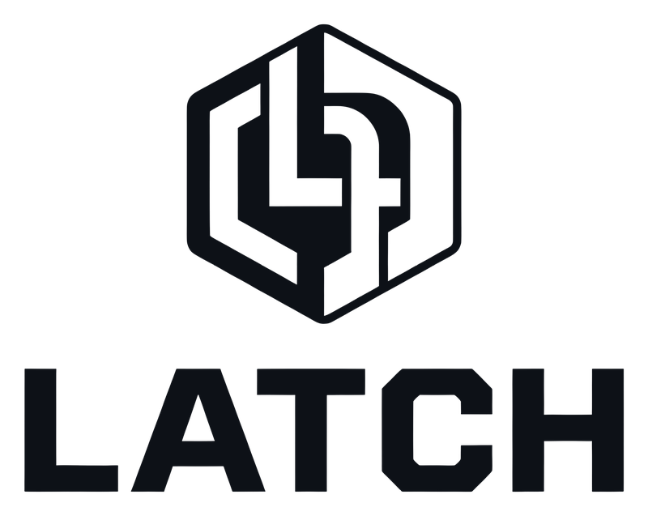

<p align="center">
  <picture>
    <source media="(prefers-color-scheme: dark)" srcset="assets/icon.png" />
    <source media="(prefers-color-scheme: light)" srcset="assets/icon-light.png" />
    
  </picture>
</p>

<h1 align="center">Latch IDE</h1>

<p align="center">
  A lightweight, open-source workspace for running AI coding agents in parallel, safely and under your control.
</p>

<p align="center">
  <a href="https://github.com/fadiljee/latch-ide/actions/workflows/ci.yml"></a>
  <a href="https://github.com/fadiljee/latch-ide/releases/latest"></a>
  <a href="LICENSE"></a>
  <a href="CONTRIBUTING.md"></a>
</p>

## What is Latch?

Latch lets you run several AI coding agents (Claude, Codex, Gemini, OpenCode, or your own scripts) side by side on the same project without them stepping on each other. Each agent works in its own isolated copy of your code. You watch what they do, review their changes, and decide what gets merged.

It is a single small app that stays light on memory, so ten agents do not cost you ten browser windows.

## Why Latch?

- **Agents collide.** Parallel agents overwrite each other's work. Latch gives every agent its own workspace.
- **Agents are trusted too much.** Latch restricts what an agent can read and write, and asks you before risky actions.
- **Costs are invisible.** Latch shows token usage and spend live, and stops runaway agents automatically.
- **Handoffs are manual.** Latch chains plan, build, verify and review into one pipeline instead of copy-paste.

## Features

- **Parallel sessions.** Run many agents at once, each in a separate isolated workspace.
- **Review before merge.** See each agent's changes as a diff, check for conflicts, then accept, reject or discard.
- **Safety by default.** Agents are sandboxed away from your private files, and sensitive actions need your approval.
- **Live usage and cost.** Track tokens and spend per session, with budget limits that cut off runaway loops.
- **Pipelines and arena.** Chain agents into workflows, or run the same task on several agents and pick the best result.
- **Integrated IDE.** Browse and edit files, search the project, and talk to agents in one window.
- **Desktop, terminal and browser.** Use the same workspace from a desktop app, a terminal UI, or the web.
- **Private and local.** Everything runs on your machine. Your code, prompts and keys are not sent anywhere by Latch.

## Install

```bash
curl -fsSL https://raw.githubusercontent.com/fadiljee/latch-ide/main/scripts/install.sh | sh
```

Then launch **Latch IDE** from your app menu, or run `latch-ide`. Linux x86_64 is supported today.

## Learn More

- [Changelog](CHANGELOG.md): what changed in each release
- [Compatibility](COMPATIBILITY.md): supported platforms and agent CLIs
- [Documentation](docs/): requirements, architecture and guides

## Community

- **Contribute:** read the [contribution rules](CONTRIBUTING.md).
- **Report a security issue:** follow the [security policy](SECURITY.md).
- **Ask or suggest:** open a [GitHub issue](https://github.com/fadiljee/latch-ide/issues).

## License

Latch is licensed under the [Apache License, Version 2.0](LICENSE).
